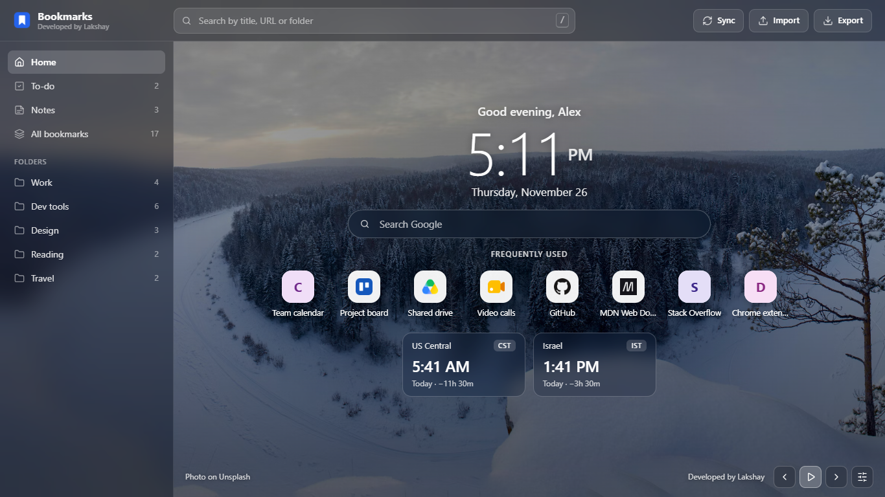
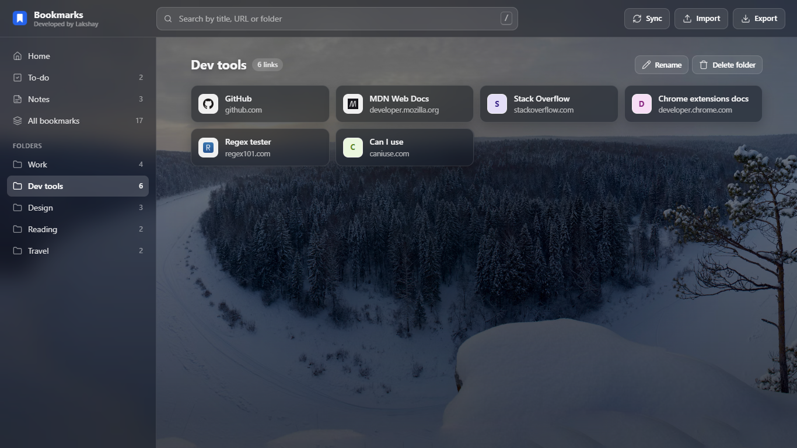
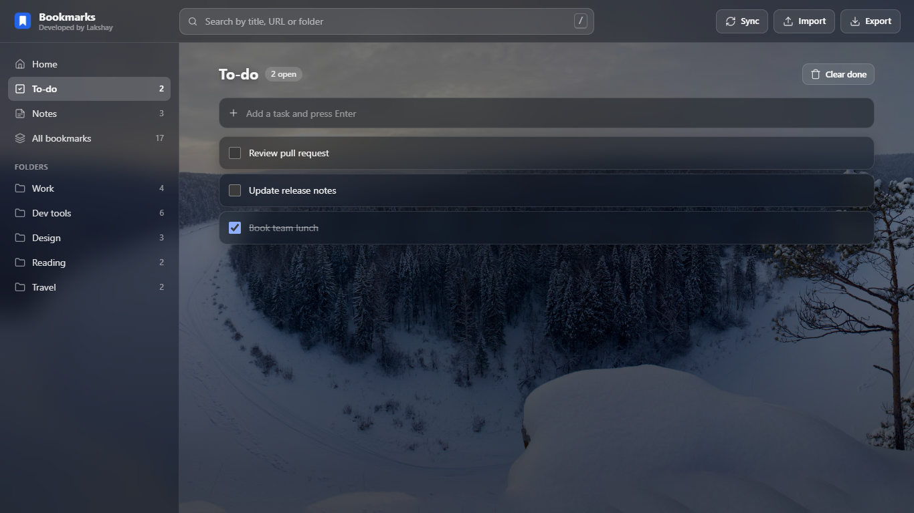
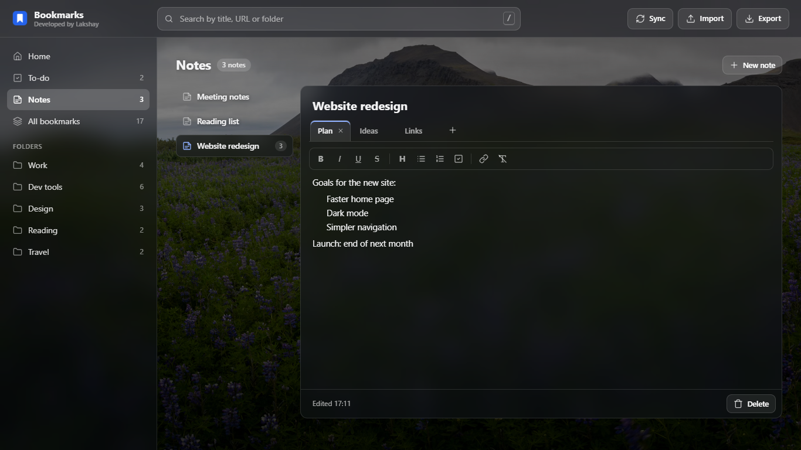
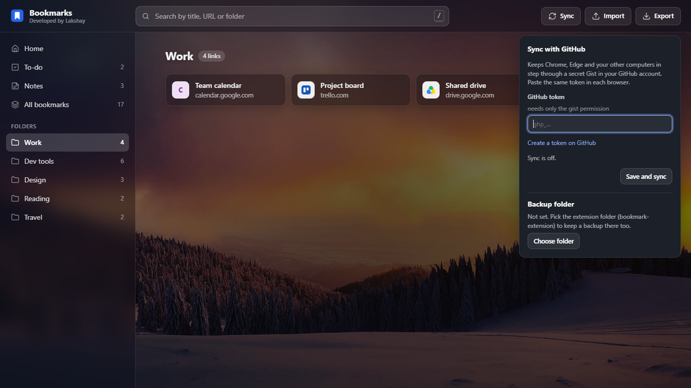

# URL Bookmarker

A Chrome extension (Manifest V3) that gives you one page for everything you keep: links saved into folders, a Home screen with a photo slideshow, clocks and your most-used sites, a to-do list, and notes with tabs. It all syncs between Chrome, Edge and your other computers through a secret GitHub Gist.

*Developed by Lakshay.*

## Screenshots

The screenshots use made-up sample data.

**Home:** greeting, clock, Google search, your 8 most-used links and world clocks, over an Unsplash slideshow.

**Folders:** every saved link as a card with its site icon. Press `/` to search all folders.

**To-do:** a simple checklist. Type a task and press Enter.

**Notes:** each note is a document with its own tabs, like OneNote.

**Sync:** paste a GitHub token once per browser, and pick a backup folder.

## Install

1. Download `url-bookmarker-<version>.zip` from [Releases](https://github.com/lakshaykumar-smartdata/url-bookmarker/releases) (or clone this repo) and unzip it to a folder that won't move, e.g. `C:\Extensions\url-bookmarker`. Avoid OneDrive, Downloads and USB drives: if Chrome can't find the folder at startup, it turns the extension off.
2. Open `chrome://extensions` and turn on **Developer mode**.
3. Click **Load unpacked** and pick that folder.
4. Pin the extension. Click it on any page to save that page into a folder. The bookmarks page stays open as a pinned tab.

## Features

- **Save from the toolbar.** The popup saves the current page into a folder (or a new one), and lets you change the title first.
- **Folders and search.** Rename, delete or drag to reorder folders; deletes can be undone.
- **To-do.** A checklist; **Clear done** removes finished tasks.
- **Notes with tabs.** Each note is a document with its own tabs, like OneNote: **+** adds a tab, click the open tab (or double-click any tab, or press F2) to rename it, drag to reorder, × deletes it (with Undo). Each note reopens on the tab you were last on. Older notes open as one tab, "Page 1".
- **Edit titles.** Hover a link and click the pencil to rename it (Enter or click away saves, Esc cancels). In the popup, edit the title box (with the pencil) before saving; on a page you already saved, changing it and clicking **Update title** renames the saved link. Renames sync to your other browsers.
- **Frequently used.** Home shows the 8 links you open most from the bookmarks page (click, Ctrl+click or middle click), as shortcut tiles under Google search. Hover a tile and click × to drop it from the row. Counts stay in this browser; they aren't synced or backed up.
- **Chrome bookmarks.** The sidebar lists your browser's own bookmark folders under *Chrome bookmarks*, below your folders. They're read-only here and update live; edit them in Chrome's bookmark manager.
- **Import** on the bookmarks page accepts this extension's JSON export or a Bonjourr backup. It only adds what's missing (links, to-dos, notes); nothing you have is changed.

## Backups

- Every change is saved as `bookmarks.json` (links, folders, to-dos, notes, greeting name, clocks and the GitHub token) in two places:
  - **This extension's folder**, once you pick it: **Sync → Backup folder → Choose folder**, then select the extension's folder. Browsers only let an extension write outside Downloads to a folder you picked, and they may ask again after a restart. The page then shows "Backup to the extension folder is paused"; click **Allow**. The file is git-ignored.
  - **Downloads/URL Bookmarker/**, always, as a fallback.
  **Export** saves the same data without the token, because that's the file you might share.
- **Reinstalled?** On first start the extension reads both backups back in by itself, before any new backup overwrites them. Nothing is replaced; missing items are added. The token comes back too, so sync turns itself on again. After a reinstall, pick the backup folder once more. Reading Downloads needs "Allow access to file URLs", which is on by default for an unpacked extension.
- The backups are read only on a fresh install, never later. Chrome and Edge both write them, so reading them again would bring back links the other browser deleted.
- Anyone who can open these folders can read the token, so give it only the `gist` permission. Turning sync off removes the token from the backups.

## Sync between browsers

Click **Sync** on the bookmarks page and paste a GitHub token that has only the `gist` permission. Do the same in each browser (Chrome, Edge, another PC) with the same token. Links are kept in a secret Gist named `url-bookmarker.json`. Each browser syncs every minute and right after a change. Deletes, folder renames, the To-do list, Notes, your Home greeting name and world clocks sync too.

You paste the token once per browser account: it is also kept in the browser's own sync (your Google account in Chrome, Microsoft account in Edge), so another PC signed in to the same account turns sync on by itself within a minute or two. The `key` in manifest.json fixes the extension ID (`dahemekchifjfjfbccdkpagnfdgebdbl`) in every browser and folder, so this works wherever you clone it. Removing the extension deletes its copy of the token from browser sync too; reloading it is fine. **Turn off** only turns sync off on that PC.

Every change is also backed up to `Downloads/URL Bookmarker/bookmarks.json`.

## Files

| File | What it does |
| --- | --- |
| `popup.html/js` | Save the current tab into a folder |
| `bookmarks.html/js` | Bookmarks page: folders, search, rename/delete, undo |
| `home.js` | Home tab: slideshow and clocks |
| `shared.js` | Import/merge, site icons, export |
| `background.js` | Import on install, auto-backup, keeps the bookmarks tab pinned |
| `icons/make_icons.py` | Regenerates the toolbar icons (needs Pillow) |
